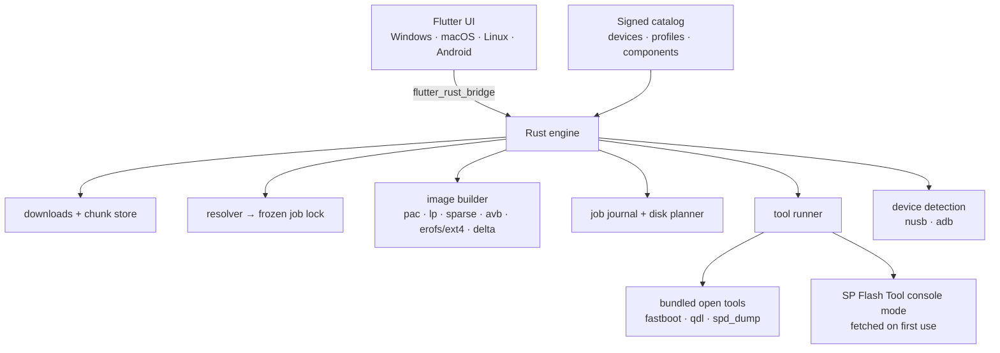

# Thimsy universal installer

Date: 2026-11-12
Status: 0.1.0 test 1 implemented for the RG Cube (see section 17)
Home: this repository (`KristopherTadlock/thimsy-os`), under `installer/`

The goal is one app, for Windows, macOS, Linux (Flatpak, plus AppImage) and
Android, that:

1. lets the user pick their handheld;
2. downloads that device's base firmware and the Thimsy Android distribution;
3. builds a patched, flashable Thimsy image for that device and the chosen
   **Light**, **Medium** or **Heavy** profile, on the user's machine;
4. walks the user through unlocking the bootloader (what the request calls
   "jailbreaking") and putting the device into its flashing mode;
5. flashes it over USB, or writes a microSD card, and checks the first boot.

The installer lives in this repository, next to the build scripts it replaces.
The device catalog, the profile definitions, the Android patch export and the
installer are all versioned and released together.

---

## 1. Decisions at a glance

| Question | Decision |
|---|---|
| UI | **Flutter**, one UI for all four platforms |
| Engine | **Rust** library, called from Dart through `flutter_rust_bridge`. It does downloads, verification, image building, the device protocols and the job journal |
| USB | **nusb** (Rust) for detecting and identifying the device on every host. The flashing itself is done by the tools in section 8 |
| Image tools | **avbroot** crates for sparse images, `super`/lp, vbmeta/AVB and boot images. **erofs-utils** and **e2fsprogs** linked or bundled for filesystems. A Rust port of `pactool.py`/`lptool.py` for Unisoc PAC |
| Shared OS | A single **Thimsy GSI system image** (`arm64_bgN`, Android 14), built once per release in CI. It is the same image on every device |
| Device differences | Placed in **odm/vendor**, never in system: drivers, keylayouts, properties, shaders and defaults. These partitions are already per-device |
| Profiles | Light/Medium/Heavy are prebuilt **system image variants** in v1, with an optional post-boot add-on pack. Building a custom system from a tree comes later |
| Base firmware | The device's **official GammaOS Next release**, downloaded from upstream GitHub and checked against pinned hashes, as `scripts/fetch.sh` does today. Manufacturer stock firmware is a per-device input only where qualified. Nothing vendor-made is rehosted |
| Recipes | **Declarative YAML** device recipes in the spirit of UBports' `installer-configs`, with a fixed set of typed actions. Catalog updates can't run code |
| Unlock | Only routes the vendor or upstream documents. Thimsy never ships or automates signature bypasses, BootROM exploits or leaked keys. A device whose only route needs one of those is **guided** (the user follows upstream's own instructions) or unsupported |
| Update trust | **minisign**-signed release manifests with an expiry, a monotonic version and two embedded public keys. Move to TUF (`tough`) if signing ever grows past one maintainer |
| Linux packaging | Flatpak (`--device=usb`, USB portal when available) plus an AppImage that can install udev rules |
| Android | Runs on a **second** phone or tablet acting as USB OTG host. Distributed on GitHub, F-Droid and Obtainium, not Play |
| First device | **RG Cube** (Thimsy already builds for it), flashed by bundled `spd_dump` on Windows and Linux |
| One app | **The whole process stays inside the installer.** Flashing tools run hidden in the background: bundled `fastboot`, `qdl` and `spd_dump` on every desktop, and SP Flash Tool's console mode (fetched on first use) for MediaTek. No vendor GUI tools, no protocol reimplementation, no Wine. The few exceptions are listed in section 8.6 |
| Two journeys | **First-time** users unlock, then do a fresh install (erases the device). **Returning** users (already unlocked) skip unlocking and choose *Update* (keeps data, only Thimsy's partitions) or *Reinstall* |
| Languages | The app and every engine message in English plus Thimsy's 21 languages (ar da de el es fi fr he it ja ko nb nl pl pt ru sv th tr zh-cn zh-tw), right-to-left for Arabic and Hebrew |
| Disk space | Checked before anything is downloaded (`space`), with a prompt when it doesn't fit; the system image streams into the firmware without being unpacked to disk; scratch files are deleted as soon as they're used; optional delete-downloads-after-use; a clean-up step at the end |
| First fully automated family | **fastboot devices** (MediaTek: Retroid Pocket 4 Pro, AYANEO Pocket Micro, KT-R1, ZPG A1). Their unlock is vendor-standard `fastboot flashing unlock` with an on-device confirmation |

---

## 2. Research findings

### 2.1 What exists in this repository today

| Finding | Where | Consequence for the installer |
|---|---|---|
| Thimsy is built by downloading the RG Cube's GammaOS Next 1.2 release, checking each 7z part's sha256, and extracting it with the password published upstream | `scripts/fetch.sh`, `scripts/build.sh` | The "download firmware" step already exists. Generalize it into a per-device `source` record |
| With `SYSTEM_IMG=`, the system comes from GammaOS Next 1.4.4 built from source (target `arm64_bgN`). The RG Cube's vendor, kernel and bootloader stay | README "1.4.4 base", `patches/thimsy/0001-thimsy.patch` | A shared GSI system with per-device vendor parts is already the model. That shared system *is* the "base file" |
| `pactool.py` reads and rewrites Unisoc PACs and fixes their CRCs. `lptool.py` replaces logical partitions in raw `super` | `scripts/` | Port both to Rust as the `pac` and `lp` adapters, and keep the Python as test oracles |
| Device-specific vendor work: a DisplayPort fix in `sprd-drm.ko` in both `vendor_dlkm` and `vendor_boot`, module load order, re-signing with the AOSP test key | `sprd_drm.py`, `patch_vendor_dlkm.py`, `patch_vendor_boot.py` | These are the RG Cube's "driver alternatives". They become typed device-pack operations, each checking the hash of its input |
| The ODM partition gets a precompiled SELinux policy matched to the system image | `odm_sepolicy.py` (needs `secilc`) | Both inputs are pinned, so **CI precompiles the policy** for each (system build, device firmware) pair. Clients never run `secilc` |
| The build loop-mounts with `sudo` | `build.sh` | The client can't do this (and Android can't at all). The client never mounts anything. See section 6 |
| Profile-shaped data already exists: `retroarch-cores.txt` (with `D - ` defaults), `added-apps.txt` (url + sha256 + source for each APK), `nano-systems.txt`, `esde-emulators.txt`, `daijisho-platforms.txt`, `hotkeys/`, `retroarch-shaders/` | `mods/` | Light/Medium/Heavy are generated from these lists, which gain a `profiles=` field |
| RG Cube specifics are mixed into generic mods: the controller layout (`27-controller-layout.sh`), `ro.gammaos.nano.no_slide`, touch orientation, the 720×720 "4:3 Cropped"/"8:7 Cropped" shaders, the external-display defaults | `mods/27-*.sh`, `mods/50-nano.sh`, README | Move them into the RG Cube device pack (odm overlay) |
| Core downloads take the "latest buildbot nightly at build time" | `mods/retroarch-cores.txt` | Not reproducible. Profiles pin core builds by sha256 and mirror them in the repo's releases |
| Measured sizes: input PAC 7.72 GB, raw `super` 5.87 GB, system 3.72 GB, compressed result 2.68 GB. The README asks for about 40 GB free | earlier measurements, README | The disk planner and the "you need N GB" screen use these as the RG Cube baseline |

### 2.2 Devices and how each family is flashed

GammaOS Next lists 34 entries ([device list][gos]). How each family
installs, from upstream's installation wiki and release pages ([wiki][goswiki]):

| Family | Devices | Upstream flashing tool | Unlock | Data wipe | Installer route |
|---|---|---|---|---|---|
| **Unisoc T820** | RG Cube, RG556, RG406H, RG406V, RG476H, RG Slide | ResearchDownload (Windows) with the full `.pac`. An upgrade flashes only FDL1/FDL2/super | Upstream ships an unlock script. Its mechanism isn't documented | Unlock and full flash wipe. Super-only upgrade keeps data | Bundled `spd_dump` on Windows and Linux (macOS to test). Unlock: see 8.6 |
| **Unisoc T618** | RG405M, RG405V, RG505 | fastboot. UpgradeDownload only to unbrick | An upstream-hosted unlock tool | Yes | Bundled `fastboot` on all desktops after a **guided** unlock (link out to upstream) |
| **Unisoc (other)** | RG Vita, RG Rotate | UpgradeDownload `.pac` | Not stated | Yes | As T820 |
| **MediaTek, fastboot** | Retroid Pocket 4 Pro, AYANEO Pocket Micro, KT-R1, ZPG A1 | Upstream's `FlashPartitions.bat`/`.sh` | `fastboot flashing unlock`, then Vol Up on the device | Yes | Bundled `fastboot` on all desktops, the first fully automated family |
| **MediaTek, SP Flash Tool** | RG557, RG477M, RG477V (Dimensity 8300), AYANEO Pocket Air Mini | SP Flash Tool (Windows) | Not stated | Yes | SP Flash Tool console mode, run hidden, on Windows and Linux. Not on macOS |
| **Qualcomm** | Mangmi Air X (QFIL/EDL), Retroid Pocket Classic (fastboot scripts) | QFIL, fastboot | Varies | Varies | RP Classic: bundled `fastboot`. Air X: bundled `qdl` on all desktops |
| **Allwinner** | GameMT E6 MAX | PhoenixSuit, after `fastboot oem unlock` | Required, documented upstream | Yes | `fastboot` unlock on all desktops. PhoenixSuit flash is an exception (8.6), Windows only |
| **Rockchip, SD self-installer** | RG Vita Pro (RK3576) | Write `*_SDCARDINSTALL.img` to microSD; the device flashes itself | Not needed | Overwrites stock | Thimsy's own microSD writer, all desktops |
| **GammaOS Nano SD images** | RG DS, RG DS Plus, TrimUI Brick, MagicX, GKD 350H Ultra | Card tools (PhoenixCard, Rockchip SD Tool) | Not needed; internal storage untouched | No | Later. Native card-format writers in the app (an exception until then, 8.6) |

Upstream notes the installer must encode as hard blocks:

- RG557: don't install if stock is v1.26.
- Retroid Pocket Classic made in March 2026 or later: don't flash.
- T618: must already be on GammaOS v1.5.1 first; no dirty flash.

**Stock firmware.** No official manufacturer download portal was found for
Anbernic, Retroid, AYANEO or AYN. Upstream links stock images on Google
Drive and Patreon, and no redistribution terms were found. GammaOS
releases are Patreon-only for their first 90 days, then public on GitHub.
So:

- The default base firmware is the device's **public** GammaOS Next release,
  fetched from GitHub. This is what Thimsy already does, and it carries the
  hardware fixes GammaOS has made to the vendor side.
- A user can **import** a local file (an early-access release, or stock for
  restore). The file is accepted only if its hash matches a catalog entry.
- Thimsy never mirrors vendor or GammaOS firmware. It mirrors only what it may
  redistribute: its own builds and open-source APKs and cores.

### 2.3 Open flashing tools

| Tool | License | Use in Thimsy |
|---|---|---|
| AOSP `fastboot` | Apache-2.0 | **Bundled**, built from source in CI for every desktop |
| `linux-msm/qdl` | BSD-3-Clause | **Bundled**: Qualcomm Sahara and Firehose with `rawprogram*.xml`/`patch*.xml`; Linux, macOS, Windows |
| `ilyakurdyukov/spreadtrum_flash` (`spd_dump`) | Unlicense | **Bundled** on Windows (WinUSB driver) and Linux; macOS to test. It needs FDL1/FDL2, which come from the user's own PAC. It doesn't parse PACs; our `pac` adapter extracts the partitions and feeds them to it. TomKing062's fork also works with Unisoc's official Windows driver, but states no license |
| bkerler/mtkclient | GPL-3.0 | Not used: SP Flash Tool's own Windows and Linux builds cover the MediaTek devices |
| bkerler/edl | GPL-3.0 plus "no commercial use without permit" | Not used: `qdl` covers the same job under BSD-3 |
| rkdeveloptool | GPL-2.0 | Not needed (the RG Vita Pro installs from microSD) |
| libwdi | LGPL-3.0 | Windows: installs WinUSB for one device when the open tools need it, with undo |
| SP Flash Tool (and, for the exceptions, PhoenixSuit and vendor card tools) | Proprietary; no redistribution terms found | **Fetched on first use** from pinned URLs and hashes, never committed or rehosted. ResearchDownload and QFIL aren't needed |
| Boxedwine | GPL-2.0 | Not used: 32-bit Wine only, no USB or serial passthrough |

### 2.4 Prior art

| Project | What we borrow |
|---|---|
| UBports Installer (Electron, GPL-3) | Per-device YAML with `user_actions` (text and pictures for manual steps), `unlock`, `operating_systems[].steps[].actions`, `condition`, `fallback`, JSON-Schema validation. Actions such as `fastboot:flash` and `core:download` |
| /e/OS web installer | One JSON per device drives a step flow; fastboot.js and ya-webadb over WebUSB |
| GrapheneOS web installer | Reads `getvar product` to pick the image, checks `unlocked` before unlocking, documents the udev and fwupd conflicts on Linux |
| Raspberry Pi Imager | Flathub precedent for a device-writing app (uses `--device=all`); ships AppImage and .deb upstream |
| EtchDroid | Writes images to USB storage from unrooted Android; ships on F-Droid and GitHub |
| LineageOS wiki | Device YAML fields: `soc`, `install_method`, `required_bootloader` |

### 2.5 App stack research

- **Flutter** supports Windows 10+, macOS 12+, Debian 10+/Ubuntu 20.04+ and
  Android API 24+. `flutter_rust_bridge` v2 (MIT) covers all four.
- **Tauri 2** is a close second, but its mobile tooling is self-described as
  immature, and the Android USB glue is the same Kotlin work.
- **Qt** is ruled out by licensing and its Windows 10 timeline.
- **Electron** has no Android.
- **USB:**
  - nusb (MIT/Apache) works on Windows (needs WinUSB), macOS (IOKit, no driver
    unless a kernel driver claimed the device) and Linux (needs udev access).
  - On Android and with Flatpak's USB portal, nusb takes the descriptor the
    platform hands out (`from_fd`).
  - Each mode switch (ADB → fastboot → download mode) re-enumerates the device,
    so permission must be requested again.
- **Flatpak:**
  - `--device=usb` arrived in Flatpak 1.15.11. Flathub's linter then requires
    `--require-version=1.16.0`.
  - The USB portal arrived in xdg-desktop-portal 1.19.1, and the app must
    declare its devices up front.
  - A Flatpak can't install host udev rules.
- **Android:**
  - Android 14 and later require a foreground-service type: `connectedDevice`
    for flashing, `dataSync` for building.
  - Apps targeting Android 15 get 6 hours of `dataSync` per 24 hours.
  - Use User-Initiated Data Transfer jobs (API 34+) for large downloads.
  - Google's sideload developer verification starts in four countries on
    2026-09-30 and goes global in 2027, so register a developer identity even
    for GitHub and F-Droid builds.
  - Play's Device and Network Abuse policy makes a flashing app a review risk.
- **Image libraries:**
  - avbroot (Rust, GPL-3.0-only) covers AVB, sparse images, `lp` packing,
    `payload.bin`, boot images and cpio.
  - `mkfs.erofs` builds from a directory or `--tar`. `mke2fs -d` takes a
    directory or tarball.
  - Pure-Rust ext4 and EROFS writers are too young to rely on.
  - No PAC library exists, so we write our own (we already have the Python).
- **Signing:**
  - `minisign-verify` (MIT, no dependencies; used by Tauri's updater) is the
    simplest.
  - `tough` (TUF, MIT/Apache) adds rollback and freeze protection and threshold
    keys, at more operational cost.

---

## 3. Distribution model: base, driver alternatives, device packs, profiles

A Thimsy installation is one resolved tuple:

```
(release, runtime variant, device pack, profile, user overrides)
```

### 3.1 Base: the Thimsy system image

- Built from GammaOSNextDistribution-14 with `patches/thimsy/` applied, plus the
  generic `mods/` (version, overlays trimmed, Nano home, hotkeys, boot
  animation, boot sound, MTP), target `arm64_bgN`.
- **One image for every device.** It holds nothing device-specific: no
  keylayouts, no panel-specific shaders, no `ro.gammaos.nano.no_slide`, no
  touch orientation.
- **Runtime variants.** The current product compiles ART for the userfaultfd
  GC (`PRODUCT_ENABLE_UFFD_GC := true`), which needs kernel support. Devices
  with older kernels need a CC variant. A device pack names the variant it
  needs.
- Built on a self-hosted runner or by the maintainer. A full Android build
  doesn't fit GitHub-hosted runners. The output is uploaded as release assets
  with a build manifest: Android tree revisions, patch digest, toolchain,
  variant and the list of installed files.

### 3.2 Driver alternatives and device packs: odm and vendor

Treble already makes `vendor` and `odm` the per-device partitions. Android
looks for keylayouts, `build.prop` and overlays in `/odm` and `/vendor` before
`/system`. So everything device-specific goes there, and the system image
stays the same on every device.

A device pack is a directory in `installer/catalog/devices/<id>/` holding:

| Slot | RG Cube example | Delivered as |
|---|---|---|
| Kernel module fixes | DisplayPort fix in `sprd-drm.ko`, module load order | A binary delta checked by input hash, applied to the user's `vendor_dlkm` and `vendor_boot` |
| SELinux | Precompiled policy for (Thimsy system, RG Cube vendor) | A small file placed in odm, computed in CI |
| Input | Positional ABXY keylayout (`mods/keylayout`), touch orientation | `/odm/usr/keylayout/*.kl`, odm `build.prop` |
| Properties | `ro.gammaos.nano.no_slide=1`, external-display defaults, LED and fan availability | `/odm/etc/build.prop` (read-only) and `/odm/etc/thimsy/defaults.json` (first boot) |
| GPU driver packs | MaliSX2 Vulkan (Mali-G57) for ARMSX2 and hakuX. Adreno devices get Turnip instead | Selected by `gpu.family`, installed by the profile's emulator post-install step |
| Global shaders | "4:3 Cropped" and "8:7 Cropped" for the 720×720 panel; RetroArch `rg_cube_*.slangp` | `/odm/etc/thimsy/shaders/`, plus RetroArch presets in the first-boot payload |
| Boot visuals | BootLogo carrying into Nano's boot screen | A device-specific logo partition operation |
| Hardware blocks | Fan, RGB, slide, HDMI/DP present or absent | `capabilities:` in the recipe. Nano hides missing features |

Driver alternatives are **slots with variants**: each variant declares when it
applies, and the resolver picks exactly one per slot.

```yaml
# installer/catalog/components/gpu-driver.yaml
slot: emulator_gpu_driver
variants:
  - id: malisx2-0.4.0
    when: { gpu.family: mali-valhall }
    artifact: { url: ".../malisx2-0.4.0.zip", sha256: "…" }
    consumers: [com.armsx2, com.rfandango.haku_x]
  - id: turnip-25.x
    when: { gpu.family: adreno-6xx-7xx }
    artifact: { url: ".../turnip-25.x.zip", sha256: "…" }
    consumers: [org.dolphinemu.dolphinemu, com.armsx2]
  - id: none
    when: {}            # fallback: emulators use the system driver
```

### 3.3 Profiles: Light, Medium, Heavy

A profile chooses **which emulators and apps ship**, **Nano's defaults** and
**each emulator's defaults**. It never changes the Android release or
overrides a hardware constraint.

| | Light | Medium | Heavy |
|---|---|---|---|
| Aimed at | Small download, older or weaker devices, classic systems | Midrange devices (default) | Capable devices (T820 and up) |
| RetroArch cores | One per system up to PS1: SameBoy, mGBA, Mesen, Snes9x, Genesis Plus GX, PicoDrive, PCSX ReARMed, FBNeo | Today's `retroarch-cores.txt` set, including Beetle PSX HW, DoubleCherryGB, gpSP, Mupen64Plus-Next | Medium plus bsnes, wider arcade, accuracy cores |
| Standalone emulators | ScummVM | + PPSSPP, Flycast, WatermelonDS, the N64 app | + Dolphin, Azahar, ARMSX2, Vita3K, hakuX |
| Home | Nano, Minima theme, fewer animations | Nano, ES-DE theme (Colorful, Simplified) | Same as Medium, richer art preloaded |
| Emulator defaults | Native resolution, no shaders, run-ahead and rewind off | Per-device tested resolution and renderer | Higher internal resolution only where the device pack says it's tested |
| Global shader | Off | Device pack's recommended preset available, off by default | Same as Medium |
| Apps | Thimsy updater, Aurora Store, file manager | + Brave as default browser | + optional network and streaming tools |
| Pack-in games | Shattered Pixel Dungeon, bundled homebrew ROMs | Same | Same |
| GPU driver pack | No | No | Yes, when the device has a variant |

The resolver filters by device capability. ARMSX2 2.9.2, for example, needs
Android 13 and ARMv8.2, so `added-apps.txt` gains `requires=` fields. A
user who picks Heavy on a weak device sees the emulators left out, and why,
before building.

**Profile file** (generated from the `mods/` lists, which gain a `profiles=`
column):

```yaml
# installer/catalog/profiles/medium.yaml
id: medium
extends: light
retroarch:
  cores: [beetle_psx_hw, doublecherrygb, gpsp, mupen64plus_next, fceumm]
  defaults: { psx: beetle_psx_hw }
apps:
  add: [ppsspp, flycast, watermelonds, brave]
  default_handlers: { browser: com.brave.browser }
nano:
  theme: esde
  props:
    persist.gammaos.nano.esde.themeset: colorful-simplified
emulator_settings:
  ppsspp: { internal_resolution: device_default }
editable: [apps.add, nano.theme, emulator_settings.*]
```

**Effective settings, lowest to highest priority:**

1. Thimsy base defaults
2. Profile
3. Device pack (tested values for this hardware)
4. User overrides, for fields marked `editable`
5. Hardware constraints, which always win

The resolved result is written to the device as
`/odm/etc/thimsy/install-manifest.json`, with a reason recorded for each value
a later layer overrode.

### 3.4 How a profile reaches the device

GammaOS installs apps at first boot from payloads in `/system/etc` (zstd
tars and `apps.list` on 1.4.4). Profiles keep using that mechanism.

- **v1: prebuilt system variants.** CI builds `system-{light,medium,heavy}`
  (× runtime variant). All three are device-independent, so there are 3–6
  system images per release, not one per device. Downloads are split into
  content-defined chunks (casync/desync-style), so a second profile or a
  second device downloads only the chunks it lacks.
- **Customization ("Medium plus Dolphin").** The extra apps go into a
  **post-boot add-on pack** in the install bundle. Thimsy's first-boot setup
  installs it, or the host pushes it over ADB once setup finishes.
- **v2: tree build.** The base ships as a tar with full metadata (owner, mode,
  SELinux label, capabilities). The engine runs `mke2fs -d`/`mkfs.erofs --tar`
  over base + profile + selection. This only replaces v1 after the Phase 0
  spike shows labels and xattrs come through intact on all four hosts.

Super has limited space. The recipe declares the free space in `super`, and
the resolver refuses a profile that doesn't fit (or moves the overflow to the
add-on pack) **before** anything downloads.

---

## 4. Device catalog and recipes

### 4.1 Recipe format

Each device has one YAML file, validated against a JSON Schema in CI. The
design follows UBports' `installer-configs`, with namespaces for our flashing
methods.

```yaml
# installer/catalog/devices/anbernic-rg-cube.yaml
id: anbernic-rg-cube
name: Anbernic RG Cube
aliases: [RGCube]
photos: [front.webp, buttons-download-mode.webp]
soc: { vendor: unisoc, model: t820 }
gpu: { family: mali-valhall }
display: { width: 720, height: 720, aspect: "1:1" }
capabilities: [fan, rgb, displayport, touch]
runtime_variant: uffd
identify:
  adb:      { "ro.product.model": "RG Cube" }        # verify on hardware
  download: { usb: "1782:4d00" }                     # Unisoc download mode, verify
support:
  build: verified
  install: { windows: automated, macos: untested, linux: automated, android: none }
  boot: qualified
blocks: []
sources:
  - id: gammaos-1.2-rgcube
    kind: gammaos_release
    url: https://github.com/TheGammaSqueeze/GammaOSNext/releases/download/v.1.2.0-ANBERNICRGCUBE/
    parts:
      - { name: RG_Cube_GammaOS_Next_Full_v1.2.7z.001, sha256: d7b3a4ee… }
      # … 002-005, as in scripts/fetch.sh
    archive: { format: 7z, password_ref: upstream_release_notes }
    container: { format: pac, expect_sha256: "…" }
device_pack: rg-cube@3
build:
  - pac:open
  - lp:replace       { partition: system_a, image: "@system", grow_into_free: true }
  - delta:apply      { partition: vendor_dlkm, delta: sprd-drm-dp.bsdiff, in_sha256: "…", out_sha256: "…" }
  - delta:apply      { partition: vendor_boot, delta: vendor-boot.bsdiff, in_sha256: "…", out_sha256: "…" }
  - avb:resign       { partition: vendor_boot, key: aosp-test-rsa4096 }
  - odm:overlay      { from: "@device_pack/odm", sepolicy: "@device_pack/precompiled_sepolicy" }
  - logo:replace     { from: "@device_pack/bootlogo.bmp" }
  - pac:set_version  { product: "Thimsy {release} {profile}" }
  - pac:finalize     # CRCs
unlock:
  route: guided
  guide: docs/installer/devices/rg-cube/unlock.md   # links to upstream's procedure
install:                       # same on Windows, Linux, macOS
  - user_action: backup
  - driver:ensure  { usb: "1782:4d00", driver: winusb }    # Windows only
  - spd:backup     { partitions: [prodnv, miscdata] }       # names to confirm
  - user_action: enter_download_mode
  - spd:flash      { from: "@output/pac", partitions: [super, vendor_boot, odm, logo] }
  - user_action: first_boot
upgrade:            # an unlocked device, same base: keeps data
  - spd:flash      { from: "@output/pac", partitions: [super] }
```

### 4.2 Action set

The engine implements a fixed set of actions, and recipes can only combine
them. A downloaded catalog can't add a shell command, a new executable or an
action the installed app version doesn't know (the schema carries a
`min_installer_version`).

| Namespace | Actions |
|---|---|
| `core:` | `download`, `verify`, `extract`, `unpack`, `user_action`, `condition`, `fail` |
| `pac:` | `open`, `replace`, `set_version`, `finalize` |
| `lp:` | `open`, `replace`, `resize`, `pack` (`super`) |
| `sparse:` | `pack`, `unpack` |
| `avb:` | `resign` (test keys only), `set_flags`, `verify` |
| `boot:` | `unpack`, `repack`, `replace_ramdisk_file` |
| `delta:` | `apply` (bsdiff with input and output hashes) |
| `odm:` / `vendor:` | `overlay` (rebuild the filesystem with an added file tree, keeping labels, UUID and features) |
| `fastboot:` | `wait`, `getvar`, `assert_var`, `flashing_unlock`, `flash`, `erase`, `set_active`, `reboot`, `reboot_fastbootd` (bundled `fastboot`) |
| `spd:` | `backup`, `flash` (bundled `spd_dump`, fed from our PAC parser) |
| `qdl:` | `flash` (bundled `qdl` with the package's programmer and XML) |
| `spflash:` | `download` (SP Flash Tool console mode, Windows and Linux) |
| `driver:` | `ensure`, `restore` (Windows: libwdi WinUSB or a fetched vendor driver) |
| `tool:` | `ensure` (fetch a pinned proprietary tool on first use) |
| `embedded:` | `walkthrough` (only for the exceptions in 8.6; an in-app page with USB watching) |
| `adb:` | `wait`, `getprop`, `reboot`, `push`, `install`, `pull` (backup) |
| `sdcard:` | `select_card`, `write_image`, `verify` |

### 4.3 Support levels

Support is recorded per (device, accepted firmware hash, host OS). A
successful build never switches on a flash button by itself.

| Level | Promise to the user |
|---|---|
| `candidate` | Listed with "not yet supported" and a link to the tracking issue |
| `build: verified` | The image builds and validates. Export works |
| `boot: qualified` | A maintainer booted it and passed the hardware checklist |
| `install: guided` | Only for the exceptions in 8.6: an in-app walkthrough of a step the app can't run itself |
| `install: automated` | The app runs the flash itself on that host (bundled `fastboot`/`qdl`/`spd_dump`, or SP Flash Tool's console mode), tested end to end |

The catalog can withdraw a combination without an app update (the signed
manifest carries a revocation list). A job that is already flashing finishes
on the recipe it froze when it started.

### 4.4 Rollout order

| Wave | Devices | Why |
|---|---|---|
| 1 | RG Cube | Thimsy's existing target. Bundled `spd_dump` on Windows and Linux |
| 2 | RP4 Pro, Pocket Micro, KT-R1, ZPG A1 | Vendor-standard fastboot unlock and flashing on every desktop |
| 3 | RG556, RG406H/V, RG476H, RG Slide, RG Vita, RG Rotate | Same tools as the RG Cube |
| 4 | RG405M/405V/505, RP Classic, Mangmi Air X | `fastboot` and `qdl` |
| 5 | RG557, RG477M, RG477V, Pocket Air Mini | SP Flash Tool (Windows, Linux) |
| 6 | RG Vita Pro, E6 MAX | microSD writer; E6 MAX via the 8.6 exception |
| Later | Nano SD-card devices | Native card-format writers |

Each device needs its own qualification. The system image is shared, but each
vendor's kernel must support the Thimsy runtime variant. AOSP's `check_vintf`
runs against each device's extracted vendor manifests in CI, then on hardware.

---

## 5. Installer architecture



### 5.1 Layout in this repository

```text
installer/
  app/                     Flutter app (lib/, android/, windows/, macos/, linux/)
  engine/                  Cargo workspace
    crates/
      catalog/             schema types, signature check, resolver
      fetch/               resumable downloads, chunk store, mirrors, local import
      container/           7z, PAC (port of scripts/pactool.py), raw/sparse
      lp/                  super (port of scripts/lptool.py, plus avbroot lp)
      fsimage/             erofs/ext4 build and overlay (erofs-utils, e2fsprogs)
      avb/                 vbmeta, boot images (avbroot)
      delta/               bsdiff apply with hashes
      jobs/                journal, disk planner, cleanup
      transport/           USB device detection and identification (nusb)
      tools/               tool fetcher and hash cache, driver installers, command-line wrappers and output parsers, guided-tool steps
      adb/                 minimal ADB client (identify, push, install, pull)
      sdcard/              raw card writer with verification
      ffi/                 flutter_rust_bridge API
    cli/                   `thimsy-installer` headless CLI (CI, power users)
  catalog/
    devices/<id>.yaml + <id>/ (photos, odm overlay, deltas, shaders)
    components/            driver slots and variants
    profiles/              light.yaml, medium.yaml, heavy.yaml
    schema/                JSON Schemas
  tools/
    gen-profiles           mods/*.txt → profiles/*.yaml
    make-device-pack       builds deltas and precompiled sepolicy from pinned inputs
    sign-release           minisign manifest signing (offline key)
  thirdparty/
    tools.yaml             pinned vendor tools and drivers: URL, version, sha256, notes
    fastboot/ qdl/ spd_dump/   build scripts for the bundled open tools
  packaging/
    flatpak/  appimage/  windows/ (MSIX or Inno + libwdi helper)  macos/ (dmg, notarization)  android/
  tests/
    fixtures/              tiny synthetic PAC/super/sparse images
    golden/                Python builder outputs to compare against
docs/installer/
  devices/<id>/            unlock, download-mode, recovery guides with photos
  recovery.md
.github/workflows/
  installer-ci.yml         engine tests, fuzzing, schema validation, app builds for 4 platforms
  catalog-ci.yml           schema check, URL and hash liveness, check_vintf per device
  release.yml              packaging, manifest signing (manual approval)
```

`scripts/build.sh` stays as the reference until the engine's output matches
it byte for byte on the RG Cube (or differs only in documented ways). After
that, `build.sh` becomes a thin wrapper around `thimsy-installer build`.

### 5.2 Licensing of the installer

The repository is Apache-2.0, and avbroot is GPL-3.0-only. Options:

- **(a)** License `installer/` as GPL-3.0-or-later. Apache-2.0 code can be
  combined into GPL-3. The OS overlays stay Apache-2.0.
- **(b)** Call avbroot as a separate bundled executable and keep the installer
  Apache-2.0.
- **(c)** Use only the AVB, sparse and lp formats we need, written from the
  AOSP specs.

Recommendation: **(a)**. It's simplest, and every major peer installer is
GPL-3. This is an open decision for the maintainer (section 13).

### 5.3 Engine rules

- The UI never builds a command line or decides an offset. It calls engine
  APIs with job handles, and receives progress and cancellation events.
- All container parsing uses checked 64-bit arithmetic and is fuzzed (PAC
  headers, lp metadata, sparse chunks, boot headers, 7z).
- Archives are checked for path traversal, symlink escapes and expansion
  bombs.
- Each build stage is checkpointed in the journal. Each intermediate is
  deleted after its last consumer, as the build graph determines.
- Outputs are written as `.partial` and published by an atomic rename once
  validated.

---

## 6. Building the patched firmware

### 6.1 Pipeline

1. **Resolve.** Device, accepted source hash, release, runtime variant,
   profile and overrides produce a frozen **job lock** (JSON) listing every
   input hash and the expected output manifest.
2. **Plan disk.** Compute peak bytes from stage lifetimes, measure the free
   space on the chosen volume, and refuse to start rather than fail halfway.
3. **Fetch.**
   - Download in parallel: the device source from upstream, the system variant
     chunks and the device pack from Thimsy releases, and the add-on pack.
   - Resume with HTTP ranges, and verify every file's sha256 against the lock.
   - GitHub Releases limits each asset to 2 GiB, so Thimsy's large artifacts
     are chunked anyway.
4. **Unpack.**
   - Extract the 7z with the upstream password the catalog records.
   - Extract straight into the job's one working PAC. Never keep two copies
     of a 7.7 GB PAC.
5. **Assemble.** Run the recipe's `build:` actions in order:
   - Replace `system_a` in `super` with the Thimsy system, growing it into
     free space.
   - Apply vendor deltas, checking input and output hashes.
   - Overlay odm (keylayouts, props, shaders, precompiled sepolicy, install
     manifest).
   - Re-sign with AVB where the device's chain uses test keys.
   - Replace the logo, then rebuild the container and its CRCs.
6. **Validate.**
   - Partition bounds and the lp metadata round-trip.
   - Filesystem checks (`fsck.erofs`, `e2fsck -n`) and AVB descriptor checks.
   - Each partition's hash against the job lock's expected output, which CI
     computed from the same inputs, so a client build is checked against a
     known-good one.
7. **Publish.** Write the image plus `install-plan.json` (partitions to write,
   wipe or not, protected partitions) and hand them to the install
   walkthrough.
   Users can also export it as a portable bundle and flash from another host.

### 6.2 What runs where

Anything computable from pinned public inputs is computed **in CI** and
shipped small. The client only does work that touches files Thimsy may not
redistribute.

| Work | Where |
|---|---|
| Android build, profile system images | Maintainer or self-hosted builder |
| SELinux policy compile, vendor deltas, expected output hashes, `check_vintf` | CI (`tools/make-device-pack`), from pinned firmware |
| Extracting the vendor firmware, applying deltas to it, inserting system, final container | Client |

Shipping a delta against vendor files is still derived work. Where a delta
contains meaningful vendor bytes, record that in the device's asset entry
(`ASSETS.md`) and get permission or rework the delta. Calling it a patch
doesn't settle redistribution.

### 6.3 Disk, memory, time

- **RG Cube on the one-PAC path:** about 18 GB of image overlap, which comes
  from one working PAC (7.7 GB) and one `super` (5.9 GB) alive with the system
  (3.7 GB) during insertion.
- Add the downloads (about 2.7 GB compressed source plus 1.5–2.5 GB system)
  and scratch space. **The UI shows the computed requirement**, 25–30 GB as a
  starting estimate, and the build log records the measured peak so later
  estimates improve.
- **Rules:**
  - Refuse FAT32 outputs, because the PAC is over 4 GB.
  - Refuse storage that can't seek (cloud document providers).
  - Run one large job at a time.
- Keep working memory under 512 MiB by streaming. `erofs_image.py`'s
  whole-image reads are rewritten as streams.
- Progress is shown in bytes and stages, never as an invented countdown. The
  earlier 15–30 minute estimate (SSD, four cores) is to be measured.

---

## 7. User walkthrough

```
┌ Thimsy Installer ─────────────────────────────────────────────┐
│ 1 Device  2 Profile  3 Download & build  4 Unlock  5 Install  │
│                                                               │
│  [photo] Anbernic RG Cube      Unisoc T820 · 720×720          │
│          Build ✓   Install: guided (Windows) on this computer │
│                                                               │
│  Detected over USB: RG Cube (ADB)  ✓ matches                  │
└───────────────────────────────────────────────────────────────┘
```

1. **Device.**
   - Searchable grid with photos and revision notes ("RP Classic made after
     March 2026: not supported").
   - If a device is plugged in, the app tries ADB `getprop`, fastboot
     `getvar product`, or download-mode USB IDs, and flags any mismatch with
     the chosen model.
   - Shows support levels for **this** computer, for example: "Flashing
     this device needs Windows (or Linux); on macOS you can build and export".
     The device grid can be filtered to "works on this computer".
2. **Profile.**
   - Light, Medium or Heavy cards showing systems, emulators, apps, download
     size and disk needed.
   - "Excluded on this device" list with reasons.
   - Advanced: add or remove apps, choose the default browser and home theme,
     toggle shaders, pick the add-on pack.
3. **Download & build.**
   - Choose a workspace folder, with a space check and FAT32 rejection.
   - Progress per stage. Cancel is safe at any point.
   - On finish: "Export image" and "Continue to install".
4. **Back up.** Explains exactly what will be wiped and how to copy saves,
   ROMs and screenshots off. The app can pull `/sdcard` folders over ADB or
   MTP when available. The user must tick "I have backed up" before going on.
5. **Unlock the bootloader.**
   - The app detects whether the device is already unlocked (`getvar
     unlocked`, device state), and if so skips this step and the reset it
     would cause.
   - **Automated route** (fastboot devices): an illustrated walkthrough (enable
     developer options and OEM unlocking, reboot to the bootloader). Then the
     app sends `fastboot flashing unlock` and shows "Press Volume Up on the
     handheld to confirm" with a photo.
   - **Embedded route** (only the exceptions in 8.6): upstream's documented
     steps shown inside the app. The app watches USB and continues as soon as
     the device comes back unlocked.
   - Explains what unlocking means: a factory reset, an "unlocked" boot
     warning on some devices, and how to restore stock.
6. **Connect in flashing mode.**
   - Photo of the button combination and cable.
   - Live USB status: "waiting…", "seen in ADB mode, not download mode",
     "seen but no permission".
   - Fixes on the spot:
     - Windows: install the driver in-app (one UAC prompt).
     - Linux: show the udev rule, or offer the AppImage's helper.
     - Android (later, when flashing from Android arrives): request USB
       permission again.
7. **Review.** Device identity, image and profile, partitions to write,
   whether data is wiped. Big **Install** button. The approval is tied to this
   exact device and image.
8. **Install.**
   - The app runs the tool in the background. It shows progress parsed from
     the tool's output, "don't unplug" warnings and plain-language errors.
   - For the exceptions in 8.6 only, an in-app walkthrough replaces this
     step.
9. **First boot.**
   - The app waits for ADB (if the user enables it) or asks the user to
     confirm Nano's home appeared.
   - Thimsy's setup writes a readiness flag. The app reads it, or shows a
     checklist (controls, touch, audio, Wi-Fi, a game launches).
10. **Done.**
    - Keep or delete downloads and the image.
    - Save the recovery card: original firmware location, restore steps,
      device mode combos.

### 7.1 First install or update

Right after the profile, the app asks whether the device has had custom
firmware before:

| | First time | Already unlocked |
|---|---|---|
| Unlock step | Shown (the device's own route) | Skipped |
| Install mode | Fresh install: every flashable partition, data erased, NV/calibration backed up and never written | **Update** (default): only the partitions Thimsy changes, data kept, when the device already runs a compatible GammaOS/Thimsy build; or **Reinstall** (fresh install) |

### 7.2 Disk space

Before the build starts, the app runs `space` and shows what's needed and
what's free on the chosen drive; it won't start a build that doesn't fit and
offers another folder instead. For the RG Cube the build needs about 13 GB
(4.8 GB of downloads + the 7.7 GB working image); flashing needs about the
image size again for the unpacked partitions, which are deleted after
flashing. The system image is streamed straight into the firmware, never
unpacked to disk. "Delete downloads once used" removes each download after its
last use; the Done screen offers to delete downloads, scratch files and the
image (the NV backup is kept unless the user insists).

A **Recovery** entry is always on the start screen. It detects the device's
current mode, shows the device's restore procedure and finds the kept source
firmware.

---

## 8. Flash backends: one app, start to finish

**Goal: the user never leaves the Thimsy installer.** Picking the device,
downloading, building, driver setup, unlocking, flashing and the first-boot
check all happen in one window.

Flashing uses existing tools, but **the app runs them in the background and
never shows their windows**. Thimsy doesn't reimplement protocols, and doesn't
use Wine or Boxedwine. The few steps that can't be done in-app yet are listed
in 8.6, each with a plan to remove it.

### 8.1 Tool matrix

| Family (devices) | Tool the app runs (hidden) | Windows | Linux | macOS | Android host |
|---|---|---|---|---|---|
| fastboot: RP4 Pro, Pocket Micro, KT-R1, ZPG A1, RP Classic, RG405M/405V/505, E6 MAX unlock | `fastboot` (bundled) | ✓ | ✓ | ✓ | Later |
| Unisoc PAC: RG Cube, RG556, RG406H/V, RG476H, RG Slide, RG Vita, RG Rotate | `spd_dump` (bundled), fed partition by partition from our PAC parser | ✓ | ✓ | To test | Later |
| Qualcomm EDL: Mangmi Air X | `qdl` (bundled) | ✓ | ✓ | ✓ | Later |
| MediaTek SP Flash: RG557, RG477M, RG477V, Pocket Air Mini | SP Flash Tool **console mode** (fetched on first use) | ✓ | ✓ | — | — |
| Rockchip SD self-install: RG Vita Pro | Thimsy's own microSD writer | ✓ | ✓ | ✓ | Later |
| Allwinner flash stage: E6 MAX | PhoenixSuit (GUI only) | Exception (8.6) | — | — | — |
| Nano SD-card devices | Vendor card tools (GUI only) | Exception (8.6) | — | — | — |

ResearchDownload, UpgradeDownload and QFIL are **not used**: `spd_dump` and
`qdl` do their jobs from inside the app. They appear only in the docs as a
manual unbrick route of last resort.

### 8.2 Bundled tools

| Tool | License | Hosts | Notes |
|---|---|---|---|
| `fastboot`, built from AOSP source | Apache-2.0 | All desktops | |
| `qdl` (`linux-msm/qdl`) | BSD-3-Clause | Linux, macOS, Windows | Windows: WinUSB, or its `qud` backend with Qualcomm's QDLoader driver |
| `spd_dump` (`ilyakurdyukov/spreadtrum_flash`) | Unlicense | Linux, Windows (MSYS2 + libusb); macOS to test | Windows needs a libusb-compatible driver (WinUSB) on the download-mode device, `1782:4d00`. See 8.4 |

All three are built in this repository's CI and shipped inside the app.

SP Flash Tool is proprietary, so it's **fetched on first use** from a pinned
URL and sha256, and run in console mode. It's never committed or rehosted.
Whether the console mode of the version these devices need takes a scatter
file and download config non-interactively is unverified; test it in
Phase 0.

### 8.3 Unisoc with `spd_dump`, on every desktop

`spd_dump` speaks the Unisoc download protocol but doesn't read PAC files. The
installer already has the missing half: `scripts/pactool.py`, ported to Rust.
For each job the engine:

1. Opens the built PAC, reads its XML config (FDL1/FDL2 load addresses, the
   partition list) and extracts FDL1, FDL2 and the allowlisted partition
   images.
2. Backs up the calibration and NV partitions first (`read_part prodnv`,
   `miscdata` and the others the recipe names) into the job folder.
3. Starts `spd_dump --wait 300 …` **before** asking the user to connect.
   Download mode appears only briefly, so the tool must already be waiting.
4. Shows the photo: "Hold Vol− and plug in the cable now." It watches for
   `1782:4d00`.
5. Runs `fdl FDL1 <addr>`, `fdl FDL2 <addr>`, `write_part` for each allowlisted
   partition, then `reset`. It reports progress from the tool's output.
6. Waits for the device to boot, then continues to the first-boot check.

```yaml
install:                       # same steps on Windows, Linux and macOS
  - user_action: backup
  - driver:ensure   { usb: "1782:4d00", driver: winusb }      # Windows only; no-op elsewhere
  - spd:backup      { partitions: [prodnv, miscdata] }         # names per device, to confirm
  - spd:flash       { from: "@output/pac", partitions: [super, vendor_boot, odm, logo] }
  - user_action: first_boot
upgrade:
  - spd:flash       { from: "@output/pac", partitions: [super] }
```

**Caveats to settle in Phase 0, on a real RG Cube:**
- `spd_dump`'s author tested phones mainly on a T310, not the T820.
- `write_part` writes a raw file. If the partition is larger than the file,
  the rest is left undefined. Images are padded to partition size.
- An "FDL2: incompatible partition" error means the device's layout differs
  from the PAC. That requires `repartition`, which is destructive. It's
  allowed only when the recipe says so, and only after the NV backup.
- `spd_dump` exposes `erase_part` and `repartition`, which ask for typed
  confirmation. The app never uses them outside a recipe that names them.

### 8.4 Windows drivers, from inside the app

- **Unisoc.** `spd_dump` uses libusb, so the download-mode device needs WinUSB.
  Before asking the user to connect, the app pre-installs a WinUSB driver for
  `1782:4d00` with libwdi (one UAC prompt), so Windows binds it the moment
  download mode appears. Pre-installing for a device that isn't plugged in is
  untested; Phase 0 confirms it.
- **The trade-off:** while WinUSB owns that ID, Unisoc's own driver and
  ResearchDownload don't see the device. Settings → Drivers → "Restore Unisoc
  driver" undoes the change.
- **TomKing062's `spd_dump` fork** also works with Unisoc's official driver,
  which would avoid the switch. Its repository states no license, so it can't
  be bundled. Options: ask its author for a license, or add official-driver
  support to the Unlicense original ourselves.
- **Qualcomm:** `qdl --qud` with Qualcomm's driver, or WinUSB the same way.
- **MediaTek:** the MediaTek USB VCOM driver, fetched and installed by the app
  for SP Flash Tool.
- **fastboot:** Windows 10/11 bind WinUSB for many fastboot devices already.
  Otherwise the app installs it the same way.

### 8.5 How the app runs tools

- **Fixed argument templates.** Each tool runs from fixed templates compiled
  into the app version. Recipes choose partitions and files, never raw
  arguments, so a catalog update can't run an arbitrary command.
- **Progress and errors.** The app parses each tool's output into a progress
  bar and plain-language errors ("Device not found: hold Vol− while plugging
  in"). It shows the raw log on demand and includes it in the diagnostic
  bundle.
- **One tool at a time.** The app starts each tool for one step and stops it
  afterwards. The device's identity is checked again before every write step.

### 8.6 What can't stay in the app yet

| Step | Why it leaves the app | Plan to remove it |
|---|---|---|
| **T820 unlock** (RG Cube family), if units need it | Upstream's unlock script doesn't document its mechanism. Thimsy doesn't bundle or run tooling that bypasses signature checks or uses leaked keys | Ask upstream what it does and whether units need it at all. If a vendor-sanctioned method exists, automate it. Meanwhile the app shows upstream's steps in an embedded page and continues as soon as it sees the device unlocked |
| **T618 unlock** (RG405M/405V/505) | Upstream's web unlock tool, as above | Same |
| **E6 MAX flash stage** | PhoenixSuit is GUI-only | Look for a command-line or open route. Until then, an embedded walkthrough and USB watch |
| **Nano SD-card devices** | Vendor card tools are GUI-only, and their images aren't raw | Write each card format natively in Thimsy's SD writer (later) |

Everything else (all fastboot, Unisoc, Qualcomm, MediaTek and RG Vita Pro
devices) runs start to finish inside the installer on Windows. On Linux it
does too, except MediaTek on macOS.

### 8.7 Why not Wine or Boxedwine

| Option | Verdict |
|---|---|
| **Boxedwine** | No. 16/32-bit Wine for Windows, macOS, Linux and the web, with no USB, serial or hardware passthrough mentioned (its README lists even joystick support as unfinished). GPL-2 |
| **Wine** | Not supported. It can map COM ports to host serial devices but can't load vendor USB kernel drivers. The bundled native tools cover the same ground |
| **Winlator** (Android) | No evidence of USB passthrough |
| **WSL2** for flashing | No benefit: the Windows builds of the tools work directly. WSL also needs usbipd-win, an admin prompt per device, and re-attaching after every mode switch |

### 8.8 Backend rules (every tool)

- **Identify the device before every write step.** VID:PID is never enough.
  Use the product variable, model property or other evidence the recipe asks
  for.
- **Write only partitions on the allowlist.**
- **Calibration and NV partitions are always protected.** Examples are
  `prodnv`, `miscdata`, `nvram`, `nvdata`, `persist`, `modemst*`; the list is
  per device. They're backed up before any write that could reach them.
- **On interruption,** identify the device again and retry the whole
  partition.
- **No automatic relocking.**

### 8.9 Effort

| Work | Estimate |
|---|---|
| CI builds of `fastboot`, `qdl`, `spd_dump` (Windows, macOS, Linux) | 1–2 weeks |
| Tool wrappers and output parsers (fastboot, qdl, spd_dump, SP Flash console) | 2–3 weeks |
| Windows driver handling (libwdi pre-install, restore) | 1–2 weeks |
| SP Flash Tool fetch and console-mode qualification | 1–2 weeks |
| Embedded walkthroughs for the exceptions in 8.6 | 1–2 days each |
| Android: fd patches so the bundled tools flash from Android | Later, 2–3 weeks |

---

## 9. Host platforms

### Windows (10 and 11, x64; ARM64 later)
- Packaged as MSIX or an Inno Setup `.exe`, signed.
- **The primary platform:** every device can be flashed from Windows.
- **Drivers are handled in-app** (section 8.4). WinUSB is installed for the
  needed IDs through libwdi with one UAC prompt, and can be restored. The
  MediaTek VCOM driver is fetched for SP Flash Tool.

### macOS (12+, Apple Silicon and Intel while Flutter supports them)
- Signed and notarized `.dmg`.
- Bundled `fastboot` and `qdl` need no driver. `spd_dump` is to be tested.
- MediaTek SP Flash devices need a Windows or Linux PC. The app says so on
  the device screen, and still builds and exports the image.

### Linux
- **Flatpak** (primary on Flathub, or our own repo if Flathub declines):
  - `--device=usb` with `--require-version=1.16.0`.
  - Use the USB portal (xdg-desktop-portal ≥ 1.19.1) when present, with the
    catalog's devices declared.
  - `--filesystem=xdg-download` plus the document portal for the workspace.
  - No `flatpak-spawn --host`.
  - If the device can't be opened, the app shows the exact udev rule and a
    copyable command (for example
    `/etc/udev/rules.d/70-thimsy.rules` with `uaccess` tags for the listed
    IDs), and offers the AppImage as a fallback.
- **AppImage** (second channel):
  - Built on an old glibc base.
  - Includes a pkexec helper that installs the same udev rule after
    confirmation.
- An optional `.deb`/`.rpm` can ship the rule in-package.
- **Tools:** bundled `fastboot`, `qdl` and `spd_dump`, plus SP Flash Tool's
  Linux build fetched on first use. Only the Allwinner flash stage and Nano SD
  devices need Windows.

### Android (host phone or tablet; Android 10+, arm64)
- **Topology:** the handheld can't flash itself while in bootloader or
  download mode. The installer runs on a **second** Android device over OTG.
- **v1 builds and exports only.** Build on a phone (or on the handheld
  itself), then flash from a PC.
- **Flashing from Android comes later.** It needs small patches so the
  bundled open tools accept the USB handle `UsbManager` hands out (libusb
  `libusb_wrap_sys_device`). Permission must be asked again after every
  re-enumeration, and the identity checked each time. The vendor tools never
  run here.
- **Background work:**
  - Downloads run as a User-Initiated Data Transfer job.
  - Build runs in a `dataSync` foreground service, checkpointed so it survives
    the 6-hour cap and process death.
  - Flashing (later) runs in a `connectedDevice` foreground service with a
    wake lock.
- **Storage:**
  - Work in `getExternalFilesDir()`, with `StorageManager.allocateBytes()`
    to reserve space.
  - Use SAF only for imports and exports.
- **Power:** warn when the host battery is under 50% or the OTG adapter can't
  charge.
- **Distribution:**
  - Signed APK on GitHub Releases, F-Droid (reproducible build) and
    Obtainium.
  - Register a developer identity for Google's 2026–27 sideload verification.
- **Engine:** built with the NDK. erofs-utils and e2fsprogs cross-compile.
  Phase 0 confirms this.

---

## 10. Trust, updates, safety

- **Release manifest.** `catalog/manifest.json` carries:
  - every artifact's URL, size and sha256;
  - each device recipe's hash;
  - the minimum app version;
  - a revocation list;
  - a `version` (monotonic, so the app refuses older manifests);
  - an `expires` date.

  It is signed with **minisign**. The app embeds two public keys (current and
  next) for rotation. The private key stays offline with the maintainer, and
  signing is a manual step in `release.yml`. Move to TUF (`tough`) if there
  are several signers.
- **Separate checks.** The release signature, download hashes, PAC CRCs, AVB
  and the vendor bootloader's own checks are different checks. Passing one
  never stands in for another.
- **No code from the network.** Catalog updates add data (devices, URLs,
  hashes, guides), never scripts.
- **No exploits, no leaked keys.**
  - The installer only automates unlock commands the vendor's bootloader
    offers and confirms on the device.
  - Where upstream's only route depends on something else, Thimsy links to
    upstream's instructions as a guided step and doesn't bundle or run that
    tooling.
- **Logs.** The diagnostic bundle (for issue reports) holds the job lock,
  stage timings, USB events and error codes. It holds no personal files,
  account data or serial numbers unless the user includes them.

---

## 11. First boot and later updates

- **Install manifest.** Thimsy's first-boot setup reads
  `/odm/etc/thimsy/install-manifest.json` and then:
  - installs the profile's apps (and the add-on pack if present);
  - applies emulator settings through per-version adapters;
  - seeds `nano_systems.json`;
  - installs hotkeys and the device's shader presets.
- **Readiness.** It then explicitly reloads Nano's catalog (see
  `first_boot_game_launch_plan.md` for why a rescan isn't enough) and sets
  `persist.thimsy.setup_ready=1`.
- **Resumable setup.** Each step records completion, so an interrupted setup
  resumes rather than reinstalling.
- **Profile changes after install.**
  - Upgrade (Light → Medium): the app pushes an add-on pack over ADB, or
    Thimsy's updater downloads it.
  - Downgrade: removes packages the profile added and the user didn't touch.
  - Saves, ROMs, controller mappings and explicit user settings are never
    reset.
- **OS updates.** A new Thimsy release on the same device and base firmware
  uses the recipe's `upgrade:` path (super only, data kept). A new GammaOS base
  for the device is a new source entry, qualified separately.

---

## 12. Testing and release gates

**Engine**
- Fuzzing: PAC, lp metadata, sparse, boot headers, 7z, PAX tar.
- Archive attacks (traversal, symlinks, bombs).
- Byte-for-byte golden comparison with `scripts/build.sh` on the RG Cube.
- Filesystem metadata preservation (owner, mode, SELinux label, capabilities,
  UUID, feature flags).
- Interruption at every checkpoint.
- Disk-full and revoked-manifest handling.

**Platform**
- Windows: WinUSB helper on clean 10 and 11, with no effect on other devices.
- macOS: both architectures.
- Flatpak: with and without the portal.
- AppImage: udev helper.
- Android:
  - Permission lost and re-granted across mode switches.
  - Process death mid-build and the 6-hour `dataSync` cap.
  - Low storage, and a large export to SAF.
  - At least three host phones (low, mid and high end).

**Hardware, per device and accepted firmware**
- Unlock, flash, cold boot, 10 reboots.
- Controls, touch, audio, Wi-Fi/Bluetooth, sleep and wake, charging, fan and
  LEDs, external display.
- Nano reaches setup-ready, and a game per installed emulator launches, saves
  and loads.
- Shader geometry correct for the panel.
- Calibration and NV partitions unchanged after flashing.
- Stock restore works.

A device reaches `install: automated` on a host only after the full checklist
passes on that host, with the record (hashes, host OS, app version) committed
under `installer/tests/hardware/`.

---

## 13. Roadmap

| Phase | Deliverable | Exit gate |
|---|---|---|
| **0: spikes** (2–3 weeks) | erofs-utils and e2fsprogs built for Windows, macOS and Android; `mke2fs -d` tarball xattr/label fidelity; Rust PAC reader matching `pactool.py`; `fastboot`, `qdl`, `spd_dump` built in CI for all desktops; `spd_dump` flashing an RG Cube from Windows (WinUSB pre-installed with libwdi) and Linux; SP Flash Tool console mode run headless; license decision (section 5.2) | Each spike passes, or the design is revised (fall back to prebuilt images per variant if fs building fails on a host) |
| **1: headless engine + CLI** | catalog/resolver, fetch, PAC/lp/delta/avb/odm ops, journal, disk planner, `thimsy-installer build rg-cube --profile medium` | Output matches the golden RG Cube build on Linux, Windows and macOS; peak disk measured |
| **2: profiles + device packs** | `gen-profiles` from `mods/`, three system variants in the release pipeline, RG Cube device pack (odm overlay, deltas, precompiled sepolicy), setup reading the install manifest | Each profile boots on the RG Cube and launches its emulators on first boot |
| **3: Windows app** | Flutter UI for steps 1–10; in-app driver handling; `spd_dump` flash for the RG Cube; signing; recovery screen | A user new to the project installs Thimsy on an RG Cube from Windows without leaving the app |
| **4: more families** | Wrappers for `fastboot`, `qdl`, SP Flash console; waves 2–5 | Each device `install: automated` on Windows |
| **5: macOS and Linux** | Flatpak, AppImage and dmg packaging; udev and portal handling; per-host qualification | Linux covers every family except Allwinner and Nano SD; macOS covers fastboot and Qualcomm (and Unisoc if `spd_dump` passes) |
| **6: Android and expansion** | Android build-and-export app; later, fd patches so the open tools flash from Android; wave 6 and Nano SD devices; TUF if needed | Per-device and per-host gates |
---

## 14. Device-specific tweaks found in GammaOS

A search of the local GammaOS source (`gammaos-src`) found **no per-handheld
device trees**. It builds one GSI, and handheld specifics come from each
device's vendor partitions. The per-device behaviour it does have is
runtime-detected and maps onto device-pack settings:

| Tweak | Where | Applies to | Device-pack form |
|---|---|---|---|
| Screen calibration (BCSH, 3D LUT), gated on `ro.gammaos.device` | `gammaos-nano/NanoScreenCal.cpp:535` | RG DS, RG DS Plus | `settings:` + odm `build.prop` (`ro.gammaos.device`) |
| Panel mount rotation `persist.gsf.rot.<port>`, `persist.gsf.sec_rot` | `NanoMenuDrm.cpp:221` | Rotated panels | `settings:` |
| Portrait-native panel `persist.gammaos.nano.natural_orientation` | `gammaos-on-boot.sh:17` | Portrait panels | `settings:` |
| HWC overlays off on MediaTek SoCs (`ro.hardware` = mt67xx/mt87xx) | `device/gammaos/gammaos.rc:60` | MediaTek devices | Already automatic |
| Joypad uevent fix-up | `gammaos-nano.rc:197`, `joypad_uevent_fixup.sh` | TrimUI Brick | Automatic (device-name-specific) |
| RG Cube keylayout (positional ABXY), no-slide, LED/performance defaults, touch orientation, 720×720 crop shaders, DisplayPort driver fix | `thimsy/mods/27-*.sh`, `50-nano.sh`, `scripts/sprd_drm.py` | RG Cube | Today partly in the shared system (keylayout, props) and partly in the device pack (vendor deltas). **Next step:** move the keylayout and props from `/product` into the RG Cube odm overlay so the system image is truly device-independent |

### 14.1 What the RG Cube device pack changes

The base firmware is the official GammaOS release for the device, downloaded
from its upstream GitHub release (decided: Thimsy never hosts a whole
firmware). Compared with GammaOS 1.2, a Thimsy RG Cube PAC changes only the
partitions below (from `scripts/build.sh`). Kernel, bootloader, `vendor_a`,
`dtbo`, `init_boot` and every `vbmeta` stay stock.

| Changed | What and why | Needed to boot Thimsy? | Changes with each Thimsy release? |
|---|---|---|---|
| `system_a` in `super` (grown, Thimsy written in) | Thimsy itself | **Yes** | Yes (the shared system image) |
| PAC header CRCs | The flasher refuses the file otherwise | **Yes**, to flash | Yes |
| `vendor_dlkm_a` | DisplayPort driver fix (a 4K monitor panicked the kernel), Goodix touch probed first (−1.3 s), radios last, LED driver deferred | No | No |
| `VENDORBOOT`, `VENDORBOOT_B` | The same driver fix for recovery; LED driver out of the first stage (−1 s) | No | No |
| `odm_a` | Precompiled SELinux policy matching the system, so init does not compile one every boot (−1 s) | No | **Yes**: its hashes must match the system |
| `BootLogo`, `Fastboot_Logo` | Thimsy boot picture | No | Only if the logo changes |
| PAC version and alias | Labels in the flash tool | No | Yes |

Two couplings to keep in mind: the `odm` delta is rebuilt for every system
image, and the deferred LED driver relies on Thimsy's `init.rc` loading it, so
the `vendor_boot`/`vendor_dlkm` patches must not ship without a Thimsy system.
For a new device the minimum is the same as the first two rows; driver fixes
and the policy speed-up are optional per-device extras, provided the base
firmware's vendor is compatible with Thimsy's system.

## 15. Open decisions

1. **License** of `installer/`: GPL-3 with avbroot, a separate avbroot
   executable, or our own format code.
2. **Flathub or our own Flatpak repo**, given the USB permission review.
3. **Which Light/Medium/Heavy app lists are final.** Check the closed-source or
   restricted items now in the build (MiXplorer, DraStic, Mupen64Plus FZ,
   ES-DE, Magisk) against `plan_remove_unlicensed_files.md` before they enter
   any profile.
4. **Whether profiles stay prebuilt system variants** or move to on-client tree
   builds (after the Phase 0 fidelity spike).
5. **Hosting.** GitHub Releases (2 GiB per asset, chunked) or a CDN once
   bandwidth is measured.
6. **Unisoc unlock.** Confirm with upstream what the T820 unlock route does and
   whether a vendor-sanctioned method exists that the app could automate. Until
   then it stays guided.
7. **Stock-firmware restore.** Is there any source we may link to with stable
   hashes, or is restore "import your own file" only?
8. **SP Flash Tool: fetch or bundle.** This plan fetches it (and the
   MediaTek driver) on first use, because no redistribution terms were found.
   Bundling it would need MediaTek's permission.
9. **Unisoc driver on Windows.** Start with WinUSB plus a restore option.
   Should we ask TomKing062 to license the fork that works with Unisoc's own
   driver, or add that support to the Unlicense original ourselves?
10. **T820 and T618 unlocks.** Ask upstream whether RG Cube-family units
    need the unlock at all to accept a Thimsy flash, and whether a
    vendor-sanctioned method exists. This decides whether the RG Cube install
    is fully in-app.

---

## 16. References

**Local**
- `scripts/fetch.sh`, `scripts/build.sh`, `scripts/pactool.py`, `scripts/lptool.py`, `scripts/patch_vendor_boot.py`, `scripts/patch_vendor_dlkm.py`, `scripts/sprd_drm.py`, `scripts/odm_sepolicy.py`, `scripts/erofs_image.py`
- `mods/` (`added-apps.txt`, `retroarch-cores.txt`, `nano-systems.txt`, `esde-emulators.txt`, `hotkeys/`, `retroarch-shaders/`, `27-controller-layout.sh`, `50-nano.sh`)
- `README.md` (Building, 1.4.4 base, Flashing), `HOTKEYS.md`, `ASSETS.md`, `plan_remove_unlicensed_files.md`, `global_shader_extension_plan.md`, `first_boot_game_launch_plan.md`

**Devices and firmware**
- GammaOS Next device list: https://github.com/TheGammaSqueeze/GammaOSNext
- Installation guide: https://github.com/TheGammaSqueeze/GammaOSNext/wiki/GammaOS-Next-Installation
- GammaOS Nano wiki: https://thegammasqueeze.github.io/GammaOSNano-WIKI/
- Release pages, for example: https://github.com/TheGammaSqueeze/GammaOSNext/releases/tag/v.1.1.0-ANBERNICT618, …/v.1.2.1-ANBERNICRG557, …/v.1.2.0-MANGMIAIRX

**Tools and prior art**
- spreadtrum_flash: https://github.com/ilyakurdyukov/spreadtrum_flash
- mtkclient: https://github.com/bkerler/mtkclient · edl: https://github.com/bkerler/edl
- fastboot.js: https://github.com/kdrag0n/fastboot.js · rkdeveloptool: https://github.com/rockchip-linux/rkdeveloptool
- libwdi: https://github.com/pbatard/libwdi
- UBports installer and configs: https://github.com/ubports/ubports-installer, https://github.com/ubports/installer-configs
- /e/OS installer: https://gitlab.e.foundation/e/devices/eos-installer
- GrapheneOS web installer: https://grapheneos.org/install/web
- EtchDroid: https://github.com/EtchDroid/EtchDroid · RPi Imager: https://github.com/raspberrypi/rpi-imager
- LineageOS wiki device sample: https://github.com/LineageOS/lineage_wiki/blob/main/device_sample/sample.yml

**App stack**
- Flutter supported platforms: https://docs.flutter.dev/reference/supported-platforms
- flutter_rust_bridge: https://github.com/fzyzcjy/flutter_rust_bridge
- Tauri 2: https://v2.tauri.app/start/prerequisites/
- nusb: https://docs.rs/nusb/latest/nusb/
- libusb on Android: https://github.com/libusb/libusb/blob/master/android/README
- Flatpak permissions: https://docs.flatpak.org/en/latest/sandbox-permissions.html
- USB portal: https://flatpak.github.io/xdg-desktop-portal/docs/doc-org.freedesktop.portal.Usb.html
- Flathub linter: https://docs.flathub.org/docs/for-app-authors/linter
- avbroot: https://github.com/chenxiaolong/avbroot
- erofs-utils mkfs: https://erofs.docs.kernel.org/en/latest/mkfs.html
- mke2fs: https://man7.org/linux/man-pages/man8/mke2fs.8.html
- minisign-verify: https://crates.io/crates/minisign-verify · tough: https://github.com/awslabs/tough
- Android foreground service types: https://developer.android.com/develop/background-work/services/fgs/service-types
- Android 15 behavior changes: https://developer.android.com/about/versions/15/behavior-changes-15
- User-initiated data transfer: https://developer.android.com/develop/background-work/background-tasks/uidt
- App-specific storage: https://developer.android.com/training/data-storage/app-specific
- Developer verification: https://developer.android.com/developer-verification
- Play policy: https://support.google.com/googleplay/android-developer/answer/9888379

**Unverified, to confirm in Phase 0:** USB IDs in recipes; SoCs for ZPG A1,
RP Classic, Air X and RG477M; whether the T820 unlock is needed on every unit;
`mke2fs -d` tar xattr support for Android SELinux labels; erofs-utils builds
on Windows and macOS; mtkclient coverage for Dimensity chips; which loaders
(FDL, DA, Firehose) each GammaOS package actually contains; which partitions
each vendor tool backs up and restores (NV and calibration) so the engine can
match it.

[gos]: https://github.com/TheGammaSqueeze/GammaOSNext
[goswiki]: https://github.com/TheGammaSqueeze/GammaOSNext/wiki/GammaOS-Next-Installation

## 17. Implementation status (0.1.0 test 1)

Code lives in `installer/` (see `installer/README.md`).

- **Engine (Rust):**
  - **Catalog and planning:** catalog with plan resolution (profiles,
    hardware exclusions, settings precedence, journeys, host messages).
  - **Downloads:** resume, sha256 checks, import folder, cache.
  - **Firmware handling:** encrypted multi-volume 7z extraction, PAC and
    `super` editing (ported from `pactool.py`/`lptool.py`, with parity tests),
    bsdiff deltas.
  - **Builds and jobs:** journaled build jobs, space checks and cleanup.
  - **Flashing:** USB detection, `spd_dump` runner with NV backup and
    protected-partition checks, Windows WinUSB install via `wdi-simple`.
  - **Translations:** 22 languages.
- **RG Cube:** the device pack (2.2 GB shared system image + 4 deltas, about
  400 KB) rebuilds the Thimsy 1.0a test 21 PAC from the official GammaOS 1.2
  download **byte for byte** in about 1.5 minutes.
- **Checked against every published RG Cube firmware:** the same process
  rebuilds 21 of the 22 releases on this repo byte for byte (GammaOS Next
  Improved 1.0 and 1.4.4 test 1, Nano 2.0 tests 1–6 and 9–18, Thimsy 1.0a tests
  19–21), each matching its release's SHA256SUMS. The 1.0a test 22 draft is
  missing volumes; the same content, built locally, also rebuilds exactly
  (`installer/tests/verify-drafts.sh`).
- **Thimsy build scripts:** `scripts/build.sh` is unchanged and still makes the
  full firmware. `installer/tools/make-thimsy-build.sh` turns its output into
  the installer's Thimsy build (system image + patches, never a whole
  firmware) and refuses to finish unless the installer's rebuild is
  byte-identical. For now the build ships with the installer (the engine looks
  in `<app>/thimsy-build`, or downloads it from the installer release); later
  it becomes a separate GitHub release.
- **Tests:**
  - 69 unit and CLI tests on synthetic firmware, including a full synthetic
    device build.
  - `installer/tests/e2e.sh` on real firmware with a fake `spd_dump`.
  - Flutter widget tests.
- **Not yet:**
  - No real-device flash yet: the first one must be done on the RG Cube by a
    tester.
  - Light and Medium system images aren't built.
  - No code signing or notarization.
  - Flatpak and AppImage are not packaged yet; Linux ships a tar.gz.
  - Android flashing isn't available.
  - Other devices are not qualified.
